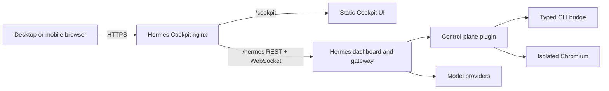

<p align="center">
  
</p>

<h1 align="center">Hermes Cockpit</h1>

<p align="center">
  <strong>A self-hosted graphical command center for Hermes Agent.</strong><br>
  Chat, Bot Mode, models, tools, browser automation, task boards, observability, and reviewed backend controls—without VNC or a desktop relay.
</p>

<p align="center">
  <a href="https://github.com/Judge-M/HermesCockpit/actions/workflows/ci.yml"></a>
  <a href="https://github.com/Judge-M/HermesCockpit/releases"></a>
  <a href="LICENSE"></a>
  
  
  
</p>

---

Hermes Cockpit is an independent browser interface for [Hermes Agent](https://github.com/NousResearch/hermes-agent). It runs beside Hermes, uses Hermes' real authenticated APIs and gateway protocol, and brings supported agent-platform workflows into one coherent interface on desktop or mobile.

**[Open the interface preview](https://judge-m.github.io/HermesCockpit/)** — the Pages build demonstrates the real responsive UI but has no Hermes backend, fake agents, or fabricated telemetry.


## See the whole system at a glance

| Workspace | What it gives you |
| --- | --- |
| 💬 **Chat** | Live Hermes terminal, model switching, saved-session history, task progress, subagents, tool activity, and browser preview. |
| 🤖 **Bot Mode** | The real Hermes Bot roster and canonical `Bot Chat` sessions—not a simulated second chat system. |
| 🗂️ **Board** | Native multi-profile Kanban boards, dependencies, workers, runs, dispatch, decomposition, and orchestration. |
| 🧠 **Models** | OAuth, API-key and OpenAI-compatible providers, model curation, assignments, auxiliary routes, and Semantic Auto. |
| 🧰 **Tools** | Toolsets, skills, MCP servers, tests, enablement, permissions, and eligible skill editing. |
| 🖥️ **System** | Verified health, runtime capacity, component state, profiles, and service status—never invented infrastructure. |
| 🎛️ **Manage** | Plain-language configuration, profiles, `SOUL.md`, raw YAML, and every API or reviewed CLI action in guided forms. |
| 📈 **Observability** | Endpoint telemetry, errors, request timing, and redacted diagnostic snapshots. |

## The desktop experience—without the desktop dependency

Cockpit reproduces the useful parts of Hermes Desktop as a responsive web application:

- real-time chat and resumable transcripts;
- Bot Mode with canonical Hermes sessions;
- live tasks, subagents, todos, and tool events;
- the packaged Chromium browser preview alongside the conversation;
- isolated-browser and copied-profile privacy controls;
- model and provider selection without an artificially shortened model list;
- a mobile layout that works over your private HTTPS or Tailscale connection.

The official Hermes web application remains the authentication authority, but routine operation stays inside Cockpit.

## Architecture



Cockpit and Hermes share one browser origin. Hermes' session cookie protects API and WebSocket traffic, while Cockpit receives short-lived connection tickets instead of passwords or long-lived tokens.

## Quick start

### Requirements

- Linux host with a working Hermes Agent `0.21.7` installation
- Docker Engine with Docker Compose
- Git
- HTTPS before exposing the service outside a trusted machine

### Install

```sh
git clone https://github.com/Judge-M/HermesCockpit.git
cd HermesCockpit
cp .env.example .env
./scripts/bootstrap.sh
```

Bootstrap performs compatibility preflight, installs the extension
transactionally, starts the pinned nginx container, and runs diagnostics. Use
`--no-start` when an existing proxy serves `dist/`.

Restart Hermes after bootstrap finishes. Then open:

1. `http://YOUR-HOST:8088/hermes/login`
2. `http://YOUR-HOST:8088/cockpit/`

The defaults assume Hermes listens on port `9119` on the Docker host. If it runs elsewhere, change `HERMES_UPSTREAM` in `.env`.

For path overrides, HTTPS guidance, an existing nginx server, and installation checks, read the **[complete installation guide](docs/INSTALL.md)**.
Supported runtime details are tracked in the **[compatibility matrix](docs/COMPATIBILITY.md)**.

## What is actually integrated

### Chat and sessions

- Authenticated REST and gateway WebSocket connections
- Random, tab-scoped terminal attachment IDs
- Automatic reconnect and keep-alive
- Recent-session search, resume, rename, archive, and export
- Native `/model` switching against the full server model catalog
- Mobile composer, terminal selection, copy, and paste

### Bot Mode and multi-agent work

- Hermes' canonical hidden `Bot Chat` session for each bot
- Existing transcript recovery instead of blank resumed sessions
- Live todo, task, subagent, and tool-event streams
- Agent dispatch and multi-profile Kanban orchestration

### Models and semantic routing

- OAuth, API-key, and custom OpenAI-compatible provider onboarding
- Credential and endpoint validation before saving
- Per-model visibility and labels
- Primary, subagent, and auxiliary model assignments
- Fixed, native automatic, and `Semantic Auto` modes
- Shared or dedicated model, tool, and memory routers
- Eligibility, fallback, shadow, verification, escalation, caching, and redacted decision history

### Browser automation

- Live frames from Hermes' packaged, isolated Chromium
- Automatic preview-panel activation during browser activity
- Opaque preview IDs; no CDP address reaches the browser
- Explicit copied-profile warning and privacy control

### Complete backend coverage

- Every operation published by Hermes' OpenAPI schema
- Every field published by `/api/config/schema`
- 170 reviewed CLI-only or partially API-backed command paths
- Typed parameters and choices derived from the installed Hermes parser
- Bounded output, secret redaction, per-user job ownership, stop controls, and destructive-action confirmation

See [Backend Coverage](BACKEND-COVERAGE.md), [CLI Coverage](CLI-COVERAGE.md), and the generated [Capability Inventory](CAPABILITY-INVENTORY.md) for the auditable contract.

## Security by design

- Cockpit does not store your Hermes password, OAuth token, provider API key, or model credentials.
- WebSockets use Hermes' short-lived, single-use ticket flow.
- Raw diagnostic output is redacted before display or copy.
- The CLI bridge executes an argument vector from a strict allowlist and never uses `shell=True`.
- Interactive jobs are scoped to the authenticated Hermes user and retain bounded output.
- Chromium's DevTools endpoint remains private to the Hermes process.
- Installation-specific service links are environment configuration, not source-code defaults.

Read [SECURITY.md](SECURITY.md) before making Cockpit reachable outside a trusted host.

## Configure your installation

The bundled Compose deployment recognizes:

| Variable | Default | Description |
| --- | --- | --- |
| `COCKPIT_PORT` | `8088` | Published Cockpit/nginx port. |
| `HERMES_UPSTREAM` | `http://host.docker.internal:9119` | Hermes dashboard origin reachable from nginx. |

The Hermes plugin can optionally read `HERMES_COCKPIT_PORTAL_URL` and `HERMES_COCKPIT_LINKS_JSON` from the Hermes service environment. No portal or infrastructure catalog is required for a standalone installation.

Full details: **[Configuration reference](docs/CONFIGURATION.md)**

## Development

Run a local static preview:

```sh
node scripts/serve.mjs
```

Open <http://127.0.0.1:4174>. Navigation and responsive layouts work locally; live operations require a same-origin `/hermes` proxy.

Run the portable checks:

```sh
node scripts/check.mjs
python scripts/validate-semantic-routing.py
python build.py --check-only
```

Contributor setup, provenance rules, browser checks, and release packaging are
covered in the **[development guide](docs/DEVELOPMENT.md)**.

Validate the CLI bridge inside Hermes' managed Python environment:

```sh
python scripts/run-cli-bridge-validation.py
```

Build a clean static release directory:

```sh
python build.py --output build/cockpit
```

## Repository map

```text
dist/                                browser application and vendored assets
server/judge-m-control-plane/        authenticated Hermes plugin
server/hermes-runtime-patches/       reviewed semantic-routing seams
deploy/nginx.conf.template           same-origin proxy configuration
scripts/install-hermes-extension.sh  plugin and patch installer
compose.yaml                         portable web deployment
docs/                                install, configuration, and upgrade guides
VERSION                              shared Cockpit and plugin release version
```

## Compatibility and honest boundaries

The currently verified target is Hermes Agent `0.21.7`. The installer refuses to force runtime patches that no longer apply cleanly.

- Primary Semantic Auto resolves when Cockpit creates a session; it does not switch a model midway through an active tool loop.
- Escalation and verification are lifecycle-safe operations, but Hermes `0.21.7` does not expose a public ordinary-turn completion hook that would safely replay active work.
- Hermes currently permits one external memory provider; multiple logical stores must remain behind that authorized provider.
- Physical Tailscale peer/ACL/traffic topology is not shown because Hermes exposes no trustworthy contract for it.

These boundaries are intentionally visible instead of being filled with mock data.

## Upgrade and rollback

See **[UPGRADING.md](docs/UPGRADING.md)** for safe plugin backups, patch compatibility, container upgrades, and rollback procedures.

## Project status

Hermes Cockpit is an independent community project and is not affiliated with or endorsed by Nous Research or the Hermes team. Each release names the exact Hermes runtime it was verified against; see the compatibility matrix before upgrading either side.

## License

Hermes Cockpit is available under the [MIT License](LICENSE). Vendored dependencies retain their own licenses; see [Third-party notices](THIRD_PARTY_NOTICES.md).

<p align="center">
  <br>
  <sub>Built to make powerful agents feel observable, controllable, and genuinely yours.</sub>
</p>
